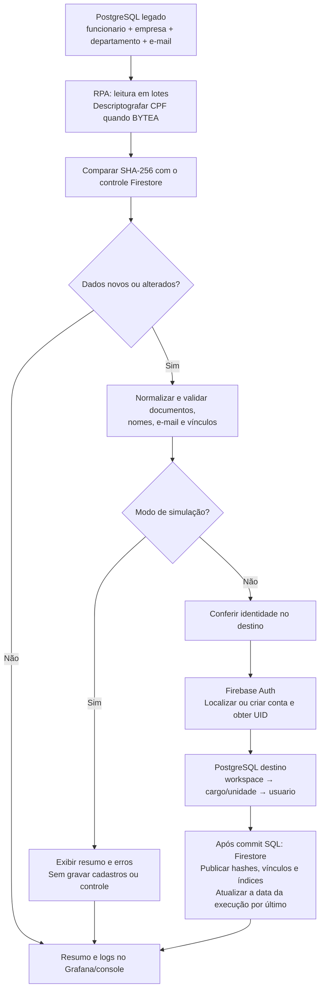

# RPA de sincronização de usuários

O RPA lê funcionários do PostgreSQL legado, valida seus dados e os organiza no
modelo do novo PostgreSQL. A empresa vira um workspace, o departamento vira uma
unidade, o cargo é cadastrado dentro do workspace e o funcionário vira um usuário
vinculado a uma conta do Firebase Authentication.

O controle de alterações e os vínculos entre os sistemas ficam no Firestore.
O RPA acessa o legado somente para leitura. O escopo atual é a sincronização de
usuários e das entidades necessárias para cadastrá-los.

Existem duas implementações: Python para execução local/Docker e TypeScript para
o Worker no Cloudflare. O Worker usa Hyperdrive para acessar os dois PostgreSQL,
Firebase Auth via REST/OAuth e Firestore via REST. O Python usa SQLAlchemy,
psycopg e Firebase Admin SDK.

## Fluxo da integração



O diagrama representa o caminho de sucesso. A execução com escrita adquire um
lock exclusivo no Firestore antes de processar os funcionários. Uma falha impede
a confirmação de sucesso; as regras de recuperação estão descritas abaixo.

## Dados extraídos do legado

O RPA percorre `funcionario`, ordenando por `id_funcionario`, em lotes definidos
por `SYNC_BATCH_SIZE` (padrão 100). No início, consulta o maior ID e limita a
varredura a esse valor. A próxima página começa após o último ID lido, sem
`OFFSET`. Funcionários inseridos com IDs maiores ficam para a próxima execução.

| Fonte | Campos lidos | Finalidade |
| --- | --- | --- |
| `funcionario` | `id_funcionario`, `cpf`, `nome`, `cargo`, `id_empresa`, `id_departamento` | Identidade na origem, documento, dados pessoais e referências organizacionais. |
| `empresa` | `nome`, `cnpj`, associados por `id_empresa` | Preparar o workspace do funcionário. |
| `departamento` | `nome`, `id_empresa`, associados por `id_departamento` | Preparar a unidade e conferir se ela pertence à empresa do funcionário. |
| `funcionario.email` | `email`, quando essa coluna existe | Preparar o e-mail de login. |
| `email` (formato anterior) | `id_funcionario`, `id_email`, `email` | Alternativa usada apenas quando `funcionario.email` não existe; mantém os e-mails ordenados por ID. |

Empresa e departamento usam `LEFT JOIN`: referências ausentes não eliminam o
funcionário silenciosamente, mas produzem erro de validação. Quando os dois
formatos de e-mail existem, a fonte escolhida é `funcionario.email`.

Se `cpf` for `BYTEA`, a consulta usa `pgp_sym_decrypt` com `LEGACY_CPF_KEY` como
parâmetro. O resultado textual segue para validação, preservando zeros à esquerda.
Se a coluna já for textual, o RPA a lê diretamente. A chave deve ser a mesma da
criptografia de origem; `pgcrypto` precisa estar acessível à conexão do legado.

A integração não lê `administrador.senha`, não migra senhas e não sincroniza NRs,
certificados, equipamentos, alertas ou cronogramas. Endereços e CNAE também não
fazem parte do payload atual de usuário/workspace/unidade.

## Como os dados são transformados

| Origem | Transformação | Destino |
| --- | --- | --- |
| `empresa.nome` e `empresa.cnpj` | Limpar o nome, remover a formatação do CNPJ e validar seus dígitos verificadores. Localizar workspace pelo CNPJ. | `workspace.nome`, `workspace.cnpj` |
| `departamento.nome` | Limpar o texto e associar ao workspace da empresa. Localizar unidade por `(workspace_id, nome)`. | `unidade.nome`, `unidade.workspace_id` |
| `funcionario.cargo` | Limpar o texto e associar ao workspace. Localizar cargo por `(workspace_id, nome)`. | `cargo.nome`, `cargo.workspace_id` |
| `funcionario.nome` | Normalizar Unicode e espaços. | `usuario.nome` e nome de exibição de uma nova conta Firebase |
| `funcionario.cpf` | Descriptografar se necessário, remover pontuação e validar 11 dígitos e verificadores. | `usuario.cpf`, como texto sem máscara |
| E-mail do funcionário | Remover espaços das extremidades, converter para minúsculas e validar o formato. | `usuario.email` e e-mail da conta Firebase |
| IDs do legado | Manter como referência de origem; não reutilizar como chave primária SQL do destino. | Controle de vínculos no Firestore |
| UID retornado pelo Firebase | Confirmar a conta e vincular o UID ao usuário SQL. | `usuario.firebase_uid` |

Os nomes são normalizados em Unicode NFC, com espaços repetidos reduzidos a um
espaço, sem remover acentos. Nomes de pessoa, workspace, unidade e cargo precisam
ter de 2 a 255 caracteres e não podem conter caracteres de controle não aceitos.

CPF e CNPJ precisam ter respectivamente 11 e 14 dígitos ASCII, com verificadores
válidos; sequências com todos os dígitos iguais são rejeitadas. Essa validação
verifica o formato matemático, sem consultar a situação cadastral dos documentos.

E-mails nulos ou vazios são ignorados. Após normalização e deduplicação, precisa
restar exatamente um e-mail válido. Endereços inválidos, ausência de e-mail ou
mais de um endereço distinto geram erro; o RPA não escolhe um login arbitrário.
A validação não confirma a existência da caixa postal.

O `id_empresa` do departamento precisa ser igual ao `id_empresa` do funcionário.
Uma relação inconsistente é rejeitada: o RPA não troca a empresa ou o
departamento automaticamente.

### Exemplo de transformação

Exemplo fictício, apenas para ilustrar a estrutura:

```text
Legado
  empresa:      nome="  Empresa   Exemplo  ", cnpj="11.222.333/0001-81"
  departamento: nome="  Operação  ", vinculado à mesma empresa do funcionário
  funcionario:  nome="  Ana   Silva  ", cargo="  Analista  "
                cpf="529.982.247-25", email=" ANA@EXAMPLE.COM "

Preparação
  workspace: nome="Empresa Exemplo", cnpj="11222333000181"
  unidade:   nome="Operação", workspace_id=<ID do workspace no destino>
  cargo:     nome="Analista", workspace_id=<ID do workspace no destino>
  usuario:   nome="Ana Silva", cpf="52998224725", email="ana@example.com"
             cargo_id=<ID do cargo>, unidade_id=<ID da unidade>
             firebase_uid=<UID confirmado pelo Firebase>
             tipo="COLABORADOR", status="PRE_CADASTRADO" (na criação)
```

## Gravação no Firebase e no novo PostgreSQL

Com `SYNC_DRY_RUN=false`, o RPA confere a identidade no PostgreSQL antes de
criar uma conta Firebase. CPF, e-mail, UID e vínculo de origem precisam apontar
para o mesmo usuário. Contas já usadas por administrador ou conta independente,
vínculos conflitantes e mudanças de workspace exigem revisão.

No Firebase Auth, uma conta existente é reaproveitada após conferir seu e-mail.
Uma conta nova recebe e-mail, nome e `emailVerified=false`, sem senha gerada pelo
RPA. O fluxo não envia convite ou e-mail de definição de senha. Contas existentes
não têm senha, nome, verificação, bloqueio ou permissões sobrescritos.

O PostgreSQL recebe, nesta ordem:

1. **Workspace:** localizar pelo CNPJ; criar se ausente ou atualizar seu nome.
2. **Cargo e unidade:** localizar pelo nome dentro do workspace; criar se ausentes
   com `ativo=true`. Entidades existentes não são reativadas automaticamente.
3. **Usuário:** criar ou atualizar nome, e-mail, CPF, UID, cargo e unidade.
   Na criação, usar `tipo=COLABORADOR` e `status=PRE_CADASTRADO`. Em atualizações,
   preservar perfil, situação, modalidade e data de criação administrados pela aplicação.

O usuário chega ao workspace por meio de `cargo_id` e `unidade_id`; não é gravado
um `workspace_id` diretamente no payload de `usuario`. Os IDs SQL são gerados
ou recuperados no destino. Nomes de cargo/unidade iguais em workspaces diferentes
representam entidades distintas. Como o nome faz parte da chave de localização,
um nome novo pode criar outra entidade, sem renomear a anterior.

## Detecção de alterações e controle no Firestore

Não há `updated_at` confiável no legado: cada execução lê novamente os
funcionários até o limite inicial de IDs. O RPA calcula um SHA-256 dos dados
extraídos, incluindo CPF já descriptografado, contexto de empresa/departamento e
e-mails ordenados por ID. Compara esse hash com o último confirmado no Firestore:

| Situação | Classificação | Ação |
| --- | --- | --- |
| Sem hash confirmado para o ID do legado | `new` | Validar e, com escrita habilitada, sincronizar. |
| Hash diferente do confirmado | `changed` | Validar e sincronizar a alteração. |
| Hash igual ao confirmado | `unchanged` | Pular validação e gravação desse funcionário. |

O hash usa dados extraídos antes da normalização final: uma mudança apenas de
espaços pode provocar reprocessamento. Recriptografar o mesmo CPF não altera seu
conteúdo lógico. `last_synced_at` é informativo; não funciona como filtro da
consulta. Exclusões no legado não removem nem desativam contas no destino.

| Documento/coleção | Uso |
| --- | --- |
| `rpa_integracoes/usuarios_legado` | Data da última execução confirmada. |
| `rpa_integracoes/usuarios_legado/usuarios/{legacy_id}` | Hash, data, ID do usuário SQL e UID Firebase. |
| `rpa_integracoes/usuarios_legado/destinos/{target_id}` | Índice de identidade do destino para a origem. |
| `rpa_integracoes/usuarios_legado/uids/{sha256(uid)}` | Índice de UID para a origem. |
| `rpa_locks/usuarios_legado` | Lock exclusivo compartilhado entre Python e Worker com escrita. |

Os cadastros de uma execução ficam em uma transação PostgreSQL. Hashes e vínculos
são preparados em memória e publicados **depois do commit SQL**. Cada documento
de usuário e seus índices são gravados atomicamente no Firestore, e a data da
execução é atualizada por último. Não são necessárias tabelas `rpa_*` no PostgreSQL.

PostgreSQL, Firebase Auth e Firestore não compartilham uma transação. Se o SQL
falhar, suas alterações sofrem rollback e os controles pendentes são descartados;
contas já criadas no Auth podem permanecer e ser reaproveitadas na próxima
execução. Se o Firestore falhar após o commit SQL, a execução informa falha e a
próxima tentativa reconcilia os usuários já gravados. Isso não é uma garantia de
rollback simultâneo dos três serviços.

O lock não expira automaticamente. Após encerramento forçado, confirme que não
há execução ativa antes de liberar `rpa_locks/usuarios_legado`. Consulte os
procedimentos de [controle e recuperação no Firestore](docs/controle-firestore.md).

## Simulação e leitura dos resultados

O Worker versionado está configurado com `SYNC_DRY_RUN=true`. Nesse modo lê o
legado e o controle Firestore, compara hashes e valida candidatos novos/alterados,
mas não cria contas, não grava cadastros e não atualiza hashes ou vínculos.
Também não testa a persistência nem todos os conflitos de identidade do destino.

| Campo do resumo | Significado |
| --- | --- |
| `total` | Funcionários lidos. |
| `new`, `changed`, `unchanged` | Classificações em relação aos hashes confirmados. |
| `validated` | Candidatos novos/alterados aprovados pela validação. |
| `invalid`, `validation_errors` | Candidatos rejeitados e contagens por campo. |
| `confirmed` | Usuários processados com escrita; só trate a execução como concluída após o evento final de sucesso. |
| `last_synced_at` | Última execução confirmada; pode ser `null` antes da primeira sincronização com escrita. |

Por exemplo, `dry_run=true`, `total=15`, `validated=15`, `invalid=0` e
`confirmed=0` significa que os 15 candidatos passaram na simulação, sem gravar.
Eles podem continuar aparecendo como `new` nas próximas simulações porque nenhum
hash foi confirmado.

Na simulação, os candidatos inválidos são acumulados no resumo. O Python retorna
código 1 quando há inválidos; atualmente o Worker pode emitir evento de sucesso
da execução acompanhado de `invalid > 0`, portanto confira ambos os campos.
Com escrita habilitada, um candidato inválido interrompe o processamento e
provoca rollback da transação SQL da execução.

## Execução no Cloudflare

O cron de [wrangler.jsonc](cloudflare/wrangler.jsonc) é `17 * * * *`: uma execução
por hora, no minuto 17 (UTC; também minuto 17 em São Paulo). O workflow
[cloudflare.yml](.github/workflows/cloudflare.yml) valida as PRs e publica o Worker
após push na `main`; o agendamento do RPA fica no Cloudflare.

| Configuração do Worker | Finalidade |
| --- | --- |
| `LEGACY_DB`, `TARGET_DB` | Bindings Hyperdrive de origem e destino. |
| `FIREBASE_PROJECT_ID`, `FIREBASE_CREDENTIALS_BASE64` | Projeto e conta de serviço, mantidos como Secrets. |
| `LEGACY_CPF_KEY` | Secret com a chave PGP do legado. |
| `FIRESTORE_DATABASE_ID` | Banco Firestore; padrão `(default)`. |
| `JOBS_TOKEN` | Secret que autentica `/status` e o disparo manual. |
| `API_ENABLED`, `JOBS_ENABLED` | Habilitação da API e do cron. |
| `SYNC_BATCH_SIZE`, `SYNC_DRY_RUN` | Tamanho do lote e simulação. |
| `GRAFANA_OTLP_ENDPOINT`, `GRAFANA_OTLP_HEADERS` | Exportação dos eventos do Worker ao Grafana. |

A conta de serviço precisa ter acesso ao Auth e permissão IAM no Firestore.
Os nomes das variáveis OTLP do Worker diferem dos usados pelo Python.

`GET /health` informa disponibilidade HTTP. `GET /status` informa configuração do
job, com autenticação Bearer. `POST /jobs/sync-users?dry_run=true` dispara uma
simulação autenticada. O cron e a API manual usam o mesmo fluxo de integração.
Enquanto `SYNC_DRY_RUN=true`, a API recusa pedidos com `dry_run=false`.
O script de deploy também exige a configuração de simulação: habilitar escrita
requer revisar essa proteção, além da variável.

Consulte [operação no Cloudflare](cloudflare/README.md) e
[deploy automático](docs/cloudflare-deploy.md).

## Execução local

Use Python 3.13 (versão da imagem Docker) ou superior, a partir da raiz do projeto:

```powershell
python -m venv .venv
.\.venv\Scripts\python.exe -m pip install -r requirements.txt -c requirements.lock
# Apenas se ainda não existir um .env:
Copy-Item .env.example .env
# Preencha o .env antes de executar.
$env:SYNC_DRY_RUN = 'true'
.\.venv\Scripts\python.exe -m app.main
```

Não é necessário executar `app.database.init_sync_control` no fluxo atual.
Esse inicializador e os adaptadores SQL antigos permanecem como implementação
legada; os pontos de entrada atuais selecionam Firestore.

Variáveis do ambiente têm prioridade sobre o `.env`. Campos obrigatórios
inválidos encerram a execução sem imprimir os valores recebidos. As credenciais
Firebase são decodificadas em memória e devem pertencer ao projeto configurado.
Base64 não é criptografia: não versione `.env`, chaves ou contas de serviço.

## Variáveis de ambiente do Python

O [.env.example](.env.example) contém os nomes e padrões sem credenciais reais.

| Variável | Uso |
| --- | --- |
| `FIREBASE_PROJECT_ID` | Projeto usado pelo Firebase Authentication e Firestore. |
| `FIREBASE_CREDENTIALS_BASE64` | JSON da conta de serviço codificado em Base64; segredo obrigatório. |
| `FIRESTORE_DATABASE_ID` | Banco de controle e de logs Firestore; padrão `(default)`. |
| `FIRESTORE_LOGS_ENABLED` | Salvar histórico operacional no Firestore; padrão `true`. |
| `LEGACY_DB_HOST` | Servidor PostgreSQL legado. |
| `LEGACY_DB_PORT` | Porta do legado; padrão `5432`. |
| `LEGACY_DB_NAME` | Nome do banco legado. |
| `LEGACY_DB_USER` | Usuário do legado, preferencialmente com acesso somente de leitura. |
| `LEGACY_DB_PASSWORD` | Senha do legado; segredo obrigatório. |
| `LEGACY_CPF_KEY` | Chave PGP usada pelo legado; obrigatória quando `funcionario.cpf` é `BYTEA`. Configure a mesma chave do SQL de origem, como segredo. |
| `TARGET_DB_HOST` | Servidor PostgreSQL destino, configurado independentemente do legado. |
| `TARGET_DB_PORT` | Porta do destino; padrão `5432`. |
| `TARGET_DB_NAME` | Nome do banco destino. |
| `TARGET_DB_USER` | Usuário do destino com as permissões necessárias para persistência. |
| `TARGET_DB_PASSWORD` | Senha do destino; segredo obrigatório. |
| `SYNC_BATCH_SIZE` | Quantidade de usuários por lote; inteiro positivo, padrão `100`. |
| `SYNC_DRY_RUN` | Simulação quando `true`. Python tem padrão `false`; o Worker versionado está configurado com `true`. |
| `LOG_LEVEL` | `DEBUG`, `INFO`, `WARNING`, `ERROR` ou `CRITICAL`; padrão `INFO`. |
| `OTEL_EXPORTER_OTLP_ENDPOINT` | Endpoint OTLP base do Grafana Cloud; opcional no desenvolvimento. |
| `OTEL_EXPORTER_OTLP_HEADERS` | Header de autenticação OTLP; segredo no formato fornecido pelo Grafana Cloud. |
| `EMAIL_ALERTS_ENABLED` | Ativa alertas de falha por e-mail; padrão `true`. |
| `SMTP_HOST` / `SMTP_PORT` | Servidor SMTP com STARTTLS; padrão `smtp.gmail.com:587`. |
| `SMTP_USER` | Conta autenticada; padrão `app.4str0@gmail.com`. |
| `SMTP_PASSWORD` | Senha de app do Gmail, mantida em segredo. |
| `EMAIL_FROM` / `EMAIL_TO` | Remetente e destinatário; ambos usam `app.4str0@gmail.com` por padrão. |

`FIRESTORE_LOGS_ENABLED=false` desativa somente o histórico operacional Python;
o controle de sincronização no Firestore continua obrigatório. Logs operacionais
podem ser gravados mesmo em simulação. Para desativar também e-mails e exportação
OTLP durante um diagnóstico local, use `EMAIL_ALERTS_ENABLED=false` e deixe as
variáveis `OTEL_EXPORTER_OTLP_*` vazias no ambiente do processo.

## Logs e diagnóstico

O Worker envia eventos resumidos ao Grafana e ao console: `rpa_sync_finished`,
`job_finished` e `rpa_sync_failed`. Use `run_id` para correlacionar a execução,
conferindo `status`, `dry_run`, contagens e, em falhas, `stage`, `dependency` e
`error_code`. Senhas, CPFs, tokens e mensagens brutas de provedores não devem
aparecer nos logs.

No Grafana/Loki, filtre pelo serviço:

```logql
{service_name="data-integration-rpa"}
```

O Python escreve no console, pode exportar OTLP ao Grafana e salvar histórico em
`rpa_execucoes` no Firestore. SMTP permite alertas de falha no Python. Esses
recursos são independentes do controle de hashes e vínculos; o Worker não usa
o envio SMTP da implementação Python.

Consulte [diagnósticos estruturados](docs/observability-diagnostics.md),
[histórico Python no Firestore](docs/logs-firestore.md) e
[alertas por e-mail](docs/alertas-email.md).

## Docker e testes

Para executar a imagem Python em simulação:

```powershell
docker build -t data-integration-rpa .
docker run --rm --read-only --tmpfs /tmp --cap-drop ALL --security-opt no-new-privileges --env-file .env -e SYNC_DRY_RUN=true data-integration-rpa
```

A imagem executa como usuário sem privilégios e recebe o `.env` somente na
execução. `requirements.lock` fixa as dependências utilizadas pelo build.

```powershell
.\.venv\Scripts\python.exe -m unittest discover -s tests -v
.\.venv\Scripts\python.exe -m pip check

cd cloudflare
npm ci
npm run check
npm test
```

Os testes usam dados fictícios e serviços simulados. `TEST_POSTGRES_URL` permite
os testes opt-in em PostgreSQL descartável; o CI configura esse banco. O teste
`auth-runtime.test.mjs` executa OAuth e leitura Firestore no runtime `workerd`,
com chave fictícia e respostas externas simuladas, cobrindo diferenças em
relação ao Node. Uma suíte aprovada não substitui verificar credenciais,
permissões e uma execução no ambiente publicado.

## Onde encontrar a implementação

| Responsabilidade | Python | Worker |
| --- | --- | --- |
| Entrada e execução | `app/main.py` | `cloudflare/worker.ts`, `cloudflare/sync-runner.ts` |
| Consulta do legado | `app/repositories/legacy_user_repository.py` | `cloudflare/repositories.ts` |
| Validação e payloads | `app/services/user_preparation_service.py`, `app/models/prepared_user.py` | `cloudflare/domain.ts` |
| Comparação por hash | `app/services/change_tracking_service.py` | `cloudflare/domain.ts`, `cloudflare/sync-runner.ts` |
| Firebase Auth | `app/services/firebase_user_service.py` | `cloudflare/firebase-auth.ts` |
| Persistência SQL | `app/repositories/target_user_repository.py` | `cloudflare/target-user-repository.ts` |
| Controle Firestore | `app/repositories/firestore_sync_state.py` | `cloudflare/firestore-state.ts` |

Detalhes adicionais: [campos do legado](docs/campos-usuarios-legado.md),
[mapeamento e validação](docs/mapeamento-e-validacao.md),
[regras do Firebase](docs/usuarios-firebase.md) e
[controle Firestore](docs/controle-firestore.md).
